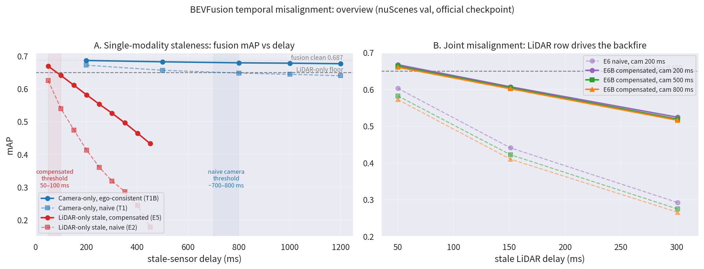
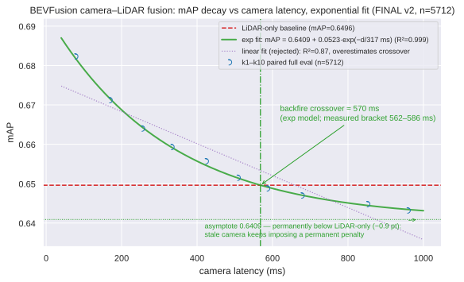
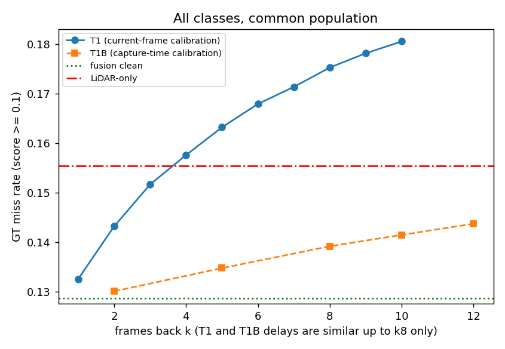
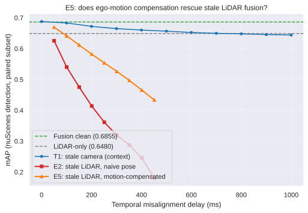
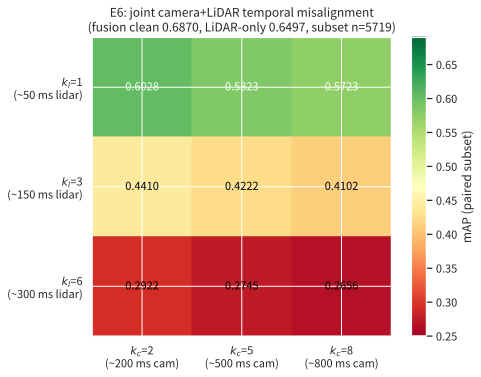
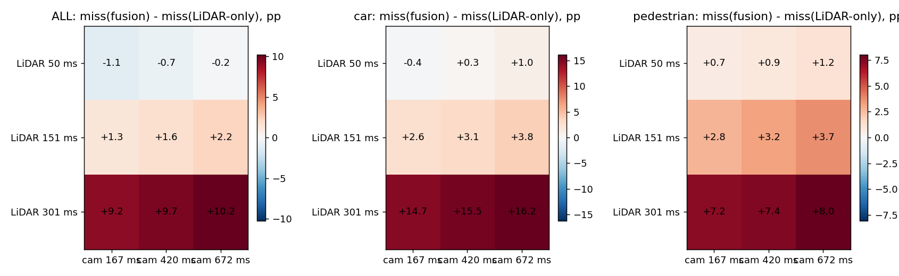
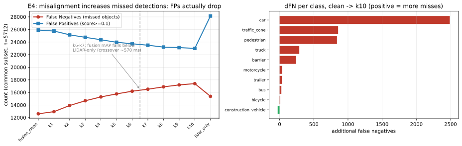
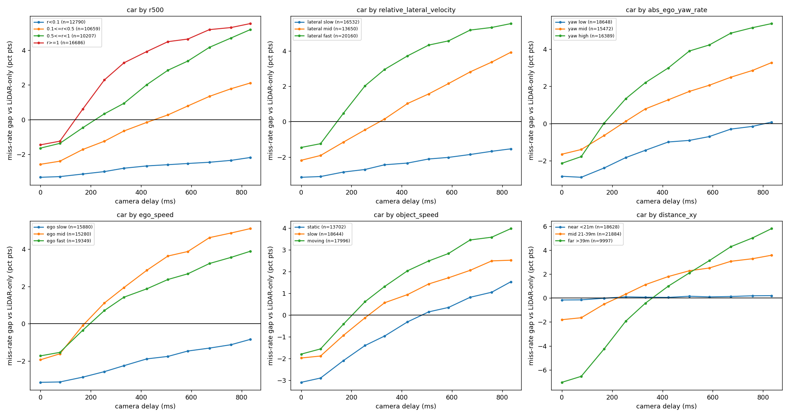
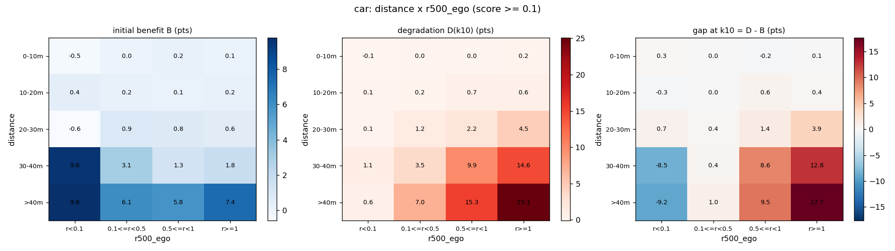
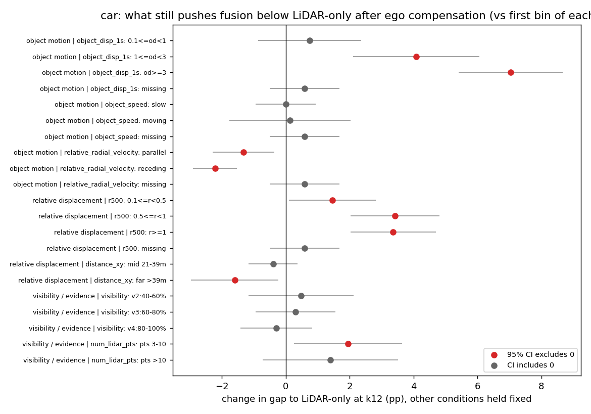

# Project Introduction

This project studies how **temporal misalignment between sensor branches** degrades a deployed camera–LiDAR fusion model. We take BEVFusion with its official nuScenes checkpoint, delay one branch at a time (or both at once), and measure not only how much accuracy is lost but **when fusion becomes worse than its own LiDAR-only fallback**.

The work sits inside a larger team effort on camera–LiDAR backfire: a metadata audit of the nuScenes trainval split that establishes where perturbation regimes are supported, and this temporal track, which runs the actual perturbed inference.

## Project Motivation and Purpose

A fusion model is only as useful as the assumption that its two inputs describe the same instant. In a real vehicle they do not: a camera frame arrives with its own exposure and transport latency, a LiDAR sweep arrives with its own processing latency, and the two are re-aligned by the pipeline before they reach the network. When that alignment is imperfect, the model does not simply become slightly less accurate — it can become **worse than ignoring one of the sensors entirely**, which is the failure mode we call backfire.

This project therefore asks three questions:

1. **How much latency can each branch absorb** before fusion drops below its LiDAR-only fallback?
2. **Does ego-motion consistency help** — that is, how much of the penalty is caused by stale data being paired with current-frame calibration, rather than by the stale content itself?
3. **Which objects break first**, and can the onset of backfire be predicted from per-object geometry and motion?

The practical output is a latency budget per sensor branch that a system designer can act on, plus a condition-level account of who pays for it.

## Scope of This Branch

This branch is a standalone, self-contained snapshot of the temporal track. It contains the full inference pipeline, the paired-subset evaluation, the FP/FN decomposition, the conditional-threshold analysis, and the reports. It deliberately excludes the spatial metadata audit of the team repository; only the two small files that the conditional analysis cites for provenance are retained.

# Dataset Overview

| Aspect | Details |
| --- | --- |
| Split | nuScenes v1.0-trainval **validation**, 6,019 keyframe samples over 150 scenes, 10 detection classes |
| What we consume | Only the **metadata tables** (~0.4 GB of JSON) — no images, no point clouds |
| Predictions | Full-validation outputs per experiment, published as GitHub Releases `predictions-v1` / `-t1b` / `-e6b` |
| Subsets | Every number is computed on the intersection of tokens present in all files of that experiment, so a missing prediction is never scored as a miss |

# Methodology

**BEVFusion (camera–LiDAR)**, official `bevfusion_lidar-cam_voxel0075_second_secfpn_8xb4-cyclic-20e_nus-3d` checkpoint, `mmdet3d` v1.4.0 / PyTorch 2.1.1 on one RTX 4090 D. Baselines were reproduced on the full validation split and every comparison uses our own baselines, because absolute mAP shifts by 0.3–0.5 points between environments.

The manipulation is minimal: **replace one branch's input with the k-th previous frame and keep calibration, ego pose and ground truth at the current instant**, unless the experiment explicitly adds ego consistency. Camera steps ~100 ms (10 Hz keyframes), LiDAR ~50 ms (20 Hz sweeps). Each axis runs **naive** (stale data, current-frame calibration) or **ego-consistent** (stale camera carries its capture-time calibration; stale LiDAR is ego-motion compensated).

| ID | Perturbation | Semantics | Paired subset |
| --- | --- | --- | --- |
| T1 / T1B | camera k1–k10 / k2–k12 | naive / ego-consistent | 5,623 |
| E2 / E5 | LiDAR k1–k9 | naive / ego-motion compensated | 5,856 |
| E6 / E6B | joint 3×3, camera {2,5,8} × LiDAR {1,3,6} | naive / ego-consistent | 5,719 |
| E1 / E4 / E7 | per-class decay, FP/FN split, density control | — | 5,712 / 5,712 / 5,869 |

Evaluation uses `detection_cvpr_2019` on identical token subsets — which matters, since an early T1B analysis reported a spurious k12 crossover purely because 88 samples were missing from one file and their boxes were counted as misses. Because aggregate mAP cannot say who pays, the conditional analysis switches to per-box **miss rate** (score 0.1, greedy matching within each sample and class, 2 m centre distance, every unmatched box a miss), conditions each box on distance, LiDAR points, velocities, ego speed and yaw rate, visibility and `r500` (relative lateral displacement in body widths over 0.5 s), and decomposes `gap(k) = D(k) − B`, where B is the clean-time camera benefit and D the delay-induced degradation: fusion backfires exactly when `D(k) > B`. Delays are measured from the substitution tables, not nominal steps: k2 167, k5 420, k8 672, k10 834, k12 1,010 ms.

# Results

## Overall Decay



Camera staleness is a shallow, convex decay with a long safe region; LiDAR staleness collapses almost immediately and then falls roughly linearly. Putting the two on one pair of axes is the main qualitative result of this project.

## Camera Staleness



Clean fusion is **0.6869** and still 0.6823 at k1 (77 ms). Fusion crosses the LiDAR-only baseline of **0.6496** between k6 and k7, and an exponential fit (R² = 0.999) puts the crossover at **568 ms** against a measured bracket of 562–586 ms — a usable budget of **0.55–0.57 s**. The fit's asymptote of 0.6409 sits permanently ~0.9 points below LiDAR-only, so deep camera staleness is a structural penalty rather than a transient one.



Delivering the stale frame with its own capture-time calibration cuts the decay to about a quarter — residual degradation at k8 falls from **4.66 to 1.05 points** — and stays above the floor out to k12 at 1,010 ms.

## LiDAR Staleness



Naive delivery fails at the first step (k1 **0.6247**, below the 0.6480 floor) and reaches 0.1787 by k9, so fusion has **not one sampling period of buffer**. Compensation buys limited relief — above the floor at k1, already below it at k2 — moving the threshold to **50–100 ms** (loader-scoped — see *The LiDAR threshold depends on how sweep history is handled*). The asymmetry is geometric: a naive pipeline loads the stale cloud with the current pose, displacing every object out of its matching radius at once, and compensation cannot repair a moving object's position in a 300 ms-old sweep.

## Joint Misalignment



With both branches naive, **every cell of the 3×3 grid falls below the floor**, including the mildest case at −4.7 points.



Compensating both branches is still not sufficient: the camera columns become almost free, but **the entire l3 row at ≈151 ms of LiDAR remains 4.4–4.8 points below the floor**. The mechanism is recall rather than hallucination — false negatives rise 38% while false positives fall 11%.

### The LiDAR threshold depends on how sweep history is handled

The stale-LiDAR runs in E2/E5/E6 replace the main cloud **and** truncate the sweep list, so staleness and the loss of motion history are entangled. E7 separates them with a 2×2 factorial on a common 5,869-token subset (clean fusion 0.6855, LiDAR-only floor 0.6479):

- **Full history, pure staleness:** S3 (≈151 ms) scores 0.6626 and S6 (≈301 ms) scores 0.6517 — **both stay above the LiDAR-only floor**, so pure stagnation does not backfire at either level.
- **Truncated history:** L3 scores 0.6106 and L6 scores 0.5254, both far below the floor. In the decomposition, density contributes only 12–18% of the loss, staleness alone 21–31%, and **57–61% is a super-additive interaction** between the two.

The 50–100 ms threshold quoted above is therefore a threshold of the **truncated-history pipeline** evaluated here, not of staleness in isolation. Under full-history staleness the crossing was not observed up to ≈301 ms, though at that point fusion's margin over LiDAR-only has shrunk from 3.8 to **+0.4 points** — the budget is larger, but not comfortable, and the exact full-history threshold remains unmeasured.



## Who Breaks First



**Relative lateral displacement r sets both the onset and the size of the backfire.** Pooled over all classes the miss-rate crossover is **135 ms** for r ≥ 1, 258 ms for 0.5 ≤ r < 1 and 519 ms for 0.1 ≤ r < 0.5, and nonexistent below 0.1; benefit lost grows from 0.9 to 7.9 points, and the ordering holds in **100%** of 500 scene-bootstrap replicates.



The B/D split explains the distance reversal: **B is governed by distance** — under 30 m the camera contributes < 1 point to a car's miss rate, beyond 40 m it contributes 6–10 — while **D is governed by apparent image displacement and amplified by distance**, rising from 0.2 to 25.1 points. Objects that gain most from an aligned camera therefore lose most from a misaligned one; far misaligned cars end 17.7 points worse than LiDAR-only. Adding ego rotation (`r500_ego`) collapses their residual distance effect from 3.9 to 0.7 points, confirming **uncompensated ego rotation** as an independent source.

## Residuals After Ego-Consistent Delivery



Ego-consistent delivery recovers about **77%** of the T1 decay, and the residual is dominated by **object displacement**: cars moving ≥3 body widths per second still show +5.27 points (adjusted effect +7.0), while pedestrians stop backfiring (−0.07 at k12). In the joint grid the LiDAR branch remains the larger lever (+100 ms costs 2.35 points against 0.90 for +505 ms of camera), and the damage is highly concentrated — boxes displaced ≥0.75 widths per 151 ms are 3.2% of the population yet carry D = 21.2 points.

## Deployment Implications

> **Under the pipeline evaluated here — which truncates sweep history — a main LiDAR sweep older than ~50–100 ms backfires: drop the camera and fall back to LiDAR-only, or run per-object temporal prediction.**
> **With full history, pure staleness did not cross the floor up to ~301 ms, but the margin shrank to +0.4 points, so the full-history budget is larger yet still unmeasured.**
> **If the LiDAR is fresh, camera frames up to ~1 s remain usable — provided they arrive with their own calibration.**

Ego-consistency is the cheapest available upgrade: no model change, only a decision about which calibration a late frame carries. It repairs geometry but not motion content, which is why the residual scales with object displacement.

# Reproducibility

The analysis side needs **no GPU, no images and no point clouds** — only the metadata JSON and the released predictions.

```bash
python step0_download.py --root /content/drive/MyDrive/nuscenes   # ~1.4 GB of predictions
python run_all.py        --root /content/drive/MyDrive/nuscenes   # 7.4 min on a Colab CPU runtime
```

Inference needs GPU: `mmdet3d` v1.4.0 with BEVFusion, `torch 2.1.1+cu121`, `mmcv 2.1.0`, `mmdet 3.2.0`, drivers in `scripts/temporal/`, run on an AutoDL RTX 4090 D streaming the 548 GB blob archive through a 50 GB work disk.

# Repository Structure

```
docs/temporal_misalignment/     ten formal reports (English and Chinese)
results/temporal_misalignment/  all numbers, figures and evaluation logs
  ├─ conditional_threshhold_analysis_t1/    per-object thresholds for T1
  ├─ conditional_threshhold_analysis_t1b/   residuals after ego-consistent delivery
  └─ conditional_threshhold_analysis_e6b/   conditional analysis of the joint grid
results/backfire_breakdown/     per-class AP for the E1 breakdown
scripts/temporal/               T1 pipeline plus the three conditional-analysis pipelines
```

Full reports are in `docs/temporal_misalignment/`; start with `results/temporal_misalignment/temporal_misalignment_synthesis_en.md`.

# Conclusions

This project produced a latency budget rather than a single accuracy number, and the budget is strongly asymmetric: **the camera branch tolerates roughly half a second of misalignment, the LiDAR branch less than two sweep cycles under the truncated-history loader** used in E2/E5/E6. The camera supplies semantics where LiDAR is sparse, so its loss is graduated; LiDAR supplies the geometric frame itself, so its loss is abrupt.

Three results were not anticipated. The camera curve has a **permanent floor** below LiDAR-only instead of converging back to it. Ego-motion compensation **cannot rescue stale LiDAR on dynamic content**, because the objects that matter are exactly the ones whose position in an old sweep is wrong. And the damage concentrates in a small, identifiable population: for the LiDAR branch, 3.2% of boxes carry the entire aggregate gap.

One claim needed qualification after the fact: the **50–100 ms LiDAR threshold is specific to the truncated-history pipeline**, since pure staleness with full history stays above the floor at ≈301 ms. Reporting a single threshold without that scope would have overstated how fragile the LiDAR branch is.

For deployment this argues for a **freshness gate plus a fallback** rather than uniform degradation handling. For measurement, aggregate mAP alone would have hidden most of the mechanism — the conditional and FP/FN decompositions were what made the failure interpretable.

## Limitations

- **Metric and populations.** The conditional analysis uses per-box miss rate rather than mAP, since mAP cannot be split by object attributes; miss rate ignores localisation error and score ranking. Each experiment is compared on its own paired subset, so cross-experiment numbers are approximate.
- **Causality.** `r500` mixes object motion with ego motion; the static-versus-moving control suggests uncompensated ego motion is a major contributor, but only a purely ego-compensated sweep would confirm it. The analysis is correlational throughout.
- **Threshold scope.** The 50–100 ms LiDAR threshold belongs to the truncated-history setup; full-history staleness was only probed at ≈151 and ≈301 ms, where it does not cross, so the threshold for a full-history implementation remains unmeasured.
- **Delay labels.** k9/k10 use the measured substitution tables (758 / 834 ms); earlier reports quoting 851 / 958 ms used nominal labels and are superseded.

# Collaborators

* [Kanghan Wang](https://github.com/nuo-ft)
* [Yangzhang He](https://github.com/jhe-sudo)
