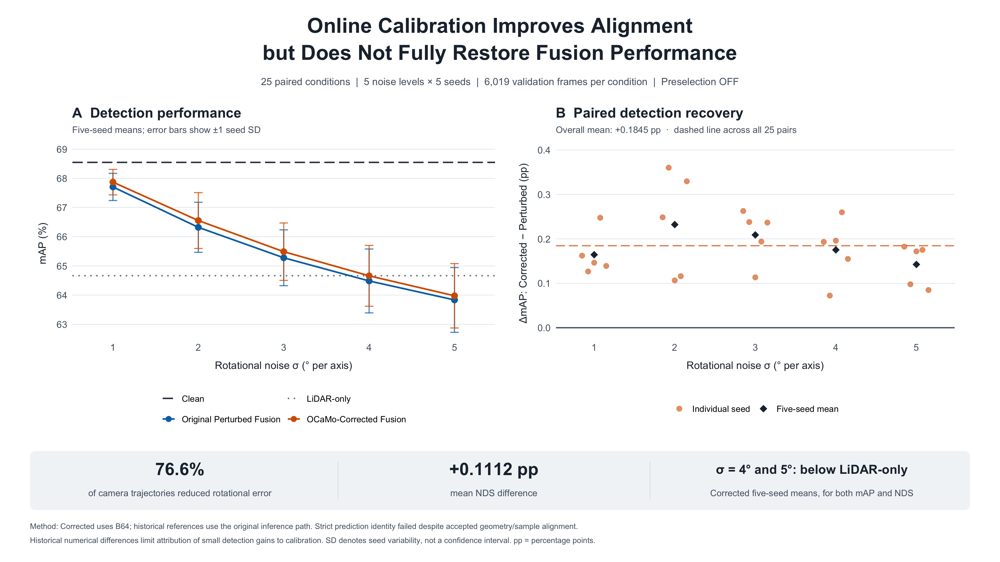
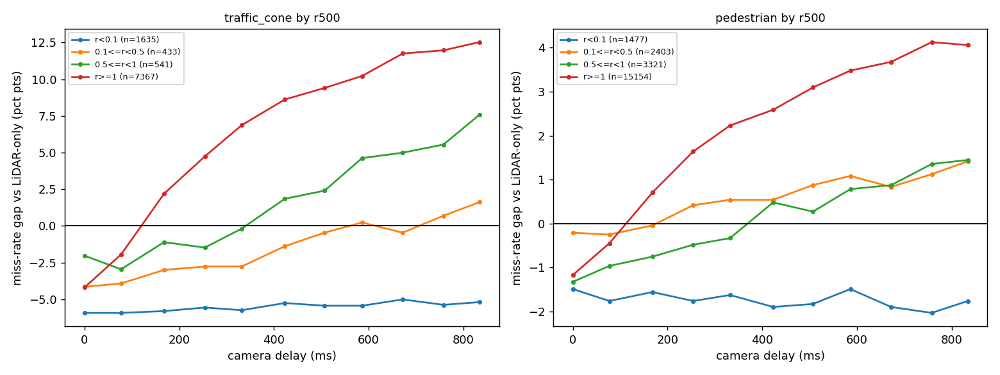

# When Fusion Backfires

### Camera–LiDAR Fusion Robustness under Spatial and Temporal Misalignment

Camera–LiDAR fusion combines visual appearance and LiDAR geometry to improve 3D object detection. However, inaccurate spatial calibration or temporal synchronization can make fusion less reliable than LiDAR-only detection.

**Our research question:** Under what conditions does sensor fusion become worse than using LiDAR alone, and how effectively can calibration and motion compensation mitigate this failure?

We investigate this question using **BEVFusion** and the **nuScenes** dataset through two parallel experimental tracks: spatial misalignment and temporal misalignment.

**Project status (November 2026):** Both research tracks have completed their principal experiments. The repository retains their independently developed implementations and provides a unified index of their results. Adaptive gated fusion remains a proposed direction, not an implemented final system.

## Research at a Glance

|Track|Main question|Principal finding|
|---|---|---|
|**Spatial Misalignment**|How do rotational calibration errors affect fusion, and can online calibration restore performance?|Fusion performance degrades with increasing rotational noise. OCaMo frequently improves calibration geometry, but downstream detection recovery is limited.|
|**Temporal Misalignment**|How does sensor staleness cause backfire, and which conditions determine vulnerability?|Camera and LiDAR timing errors have different consequences. Ego-motion consistency substantially mitigates some failures, while object-level vulnerability depends strongly on apparent displacement and initial camera benefit.|

Backfire is defined relative to a matched LiDAR-only reference under the same evaluation protocol. Results from different evaluation subsets are not treated as directly interchangeable.

## 1. Spatial Misalignment and Online Calibration

We simulated persistent rotational calibration errors independently across six cameras using five Gaussian noise levels (σ = 1°–5°) and five random seeds.

Each condition was evaluated on the complete 6,019-frame nuScenes validation set, using clean BEVFusion and LiDAR-only detection as references.

The spatial experiments show decreasing detection performance as rotational noise increases. In the five-seed mean, perturbed fusion falls below LiDAR-only at the tested σ = 4° and 5° levels; statistical uncertainty prevents claiming a sharply established crossover threshold.

We subsequently integrated an OCaMo-based online calibration method into BEVFusion, with six independent camera-specific trackers. All 25 corrected conditions were evaluated, totaling 150,475 corrected detection frames.

**Online calibration reduced rotational error in 76.6% of camera trajectories, but average detection recovery remained small: +0.1845 percentage points in mAP and +0.1112 percentage points in NDS. At σ = 4° and 5°, mean corrected fusion performance remained below LiDAR-only.**

The small corrected-versus-perturbed differences require caution because strict prediction identity between the historical Spatial inference path and the later Corrected inference path was not established.

[Spatial results and reproducibility](https://github.com/Strange-Noah/Camera-LiDAR-backfire/blob/5e8bf5701ad4db1da13d73eabd361eb10668a10e/rotation_robustness/README.md) · [OCaMo baseline](https://github.com/Strange-Noah/Camera-LiDAR-backfire/blob/85f489a840a65bacbbe139b9781fc062faac58e0/docs/ocamo/FULL_METHOD_RESULTS.md)

## 2. Temporal Misalignment and Ego-Motion Compensation

The temporal track studies stale camera images, stale LiDAR sweeps, and joint timing errors, with both naive sensor substitution and ego-consistent or compensated variants.

Its completed experiments identify several distinct failure mechanisms:

- Under the later paired camera-staleness protocol, naive camera substitution produces aggregate mAP backfire at approximately 700–800 ms, while ego-consistent camera delivery remains above LiDAR-only through approximately 1.0 s of measured delay.

- Stale LiDAR is substantially more damaging. Naive LiDAR staleness already causes backfire at the first tested approximately 50 ms offset; ego-motion compensation moves the crossover to between 50 and 100 ms.

- Joint misalignment illustrates that consistent transformations mitigate geometric errors but cannot fully recover stale dynamic object content.

These thresholds refer to specific experimental protocols and paired subsets, not universal timing limits.

[Complete temporal synthesis](https://github.com/Strange-Noah/Camera-LiDAR-backfire/blob/2e8dd75aecf6be6f2de8249f5cfce02c35fb8167/results/temporal_misalignment/temporal_misalignment_synthesis_en.md)

### Conditional Backfire

A complementary object-level analysis studies how temporal failure depends on relative lateral displacement, object size, distance, motion, and scene conditions.

Using the normalized displacement measure `r500`, the reported miss-rate crossover occurs earlier for larger displacement: approximately 135 ms for r500 ≥ 1, 258 ms for 0.5 ≤ r500 < 1, and 519 ms for 0.1 ≤ r500 < 0.5. The r500 < 0.1 group does not cross in the tested delay range.

These are **object-level miss-rate thresholds**, not aggregate nuScenes mAP thresholds.

[Conditional analysis, methods and results](https://github.com/Strange-Noah/Camera-LiDAR-backfire/blob/58b49c53e3bf452ad6b87438c5a94b72ad852cac/scripts/temporal/conditional_threshold/README.md)

## Interpretation

The two experimental tracks point toward a common conclusion:

**Fusion robustness cannot be inferred from sensor alignment alone; it must be evaluated at the downstream detection level and under the conditions in which each modality contributes useful information.**

Calibration recovery, ego-motion consistency, and object-level reliability offer complementary ways to understand or mitigate backfire. Adaptive or gated fusion is a potential next step; this repository does not claim a completed, validated universal gating policy.

## Research Documentation

- [Research overview and scientific findings](docs/research_overview.md)

- [Experiment branches, reports and reproducibility index](docs/experiment_index.md)

- [Curated results and figure provenance](results/project_summary/README.md)

## Infrastructure and Earlier Project Work

The `main` branch also retains the initial nuScenes metadata audit, deployment infrastructure, experiment-user protections and storage documentation. These are historical engineering foundations, not the complete implementation of both final research tracks.

- [Metadata audit](results/metadata_audit/README.md)

- [Audit methodology](docs/metadata_audit_methods.md)

- [Team collaboration and independent execution](docs/team_collaboration.md)

- [Dataset protection](docs/dataset_readonly.md)

- [Storage and recovery](docs/storage_and_recovery.md)

- [Experiment environment and source navigation](docs/experiment_index.md)

## Reproducibility and Scope

The experimental branches use separate environments and compute configurations. There is **no single root-level installation command** that reproduces all tracks.

Use the pinned source versions, environment instructions, evaluation populations and artifacts listed in the [experiment index](docs/experiment_index.md).

Large nuScenes data, model checkpoints and full prediction artifacts are not stored in this repository. Selected reports, figures and summary tables are included for inspection.

The repository is a research record. Experimental limitations and unverified extensions are stated separately from completed findings.
