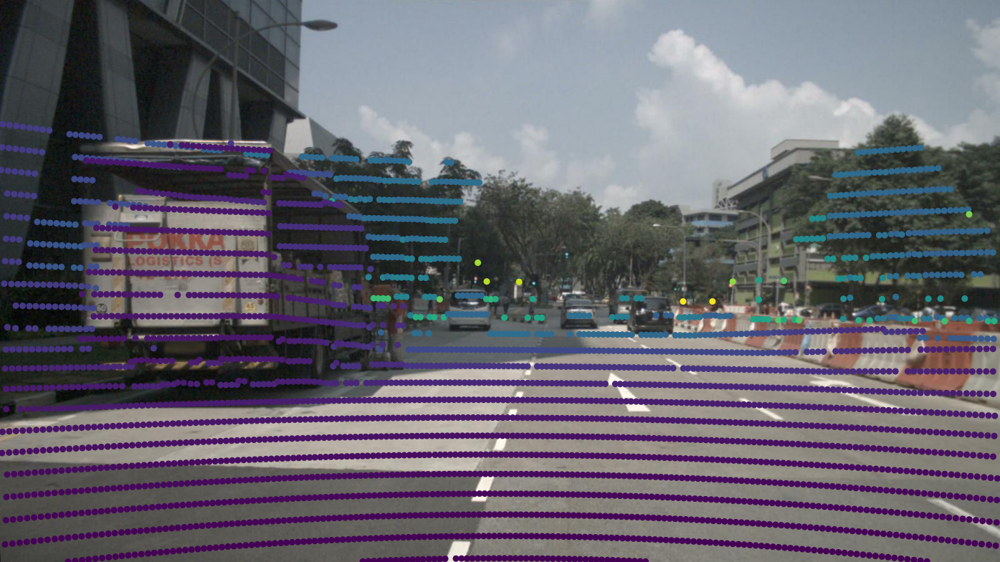

# Runpod + nuScenes Pre-Audit 部署报告

状态：**PASS — pre-audit checkpoint 已完成**。验收时间：2026-10-16T20:25:03.426366+08:00（Asia/Shanghai）。
本阶段止于基础设施、mini 数据与数据访问验证；没有执行正式 metadata audit。
运行脚本对应提交：`7f59b982b73e439dea725ed8776713cf56bb50e3`；此后的报告提交只补充文档、配置及验收材料。

## 基础设施与目录

以下资源配置来自本次 Runpod `get-pod` / `get-network-volume` 实时读取；挂载来自 Pod 内 `findmnt`。

| 项目 | 实测配置 |
|---|---|
| Datacenter / cloud | `EU-RO-1` / Secure Cloud |
| Pod | `camera-lidar-preaudit-cpu` / `fc6ypwq4yajvmj` |
| 状态 | 验收结束时 `RUNNING` |
| 算力 | `cpu3g`，4 vCPU，16 GB RAM，无 GPU |
| 镜像 | `runpod/base:1.0.2-ubuntu2404`（来自 Runpod 官方 CPU 模板目录） |
| 容器磁盘 | 20 GB，可丢弃 |
| Network Volume | `camera-lidar-backfire-data` / `p6vb29fmlu`，50 GB，STANDARD |
| 持久挂载 | `/workspace`，`fuse`，来源 `mfs#euro.runpod.net:9421[/networkvolumes/p6vb29fmlu]` |
| 数据集根目录 | `/workspace/datasets/nuscenes` |
| Pod 代码目录 | `/root/camera-lidar-backfire`，从 GitHub 克隆 |
| metadata venv | `/opt/venvs/nuscenes-metadata`，可丢弃 |
| 本地小文件备份 | `/Users/strangenoah/Desktop/AI+X/Visual_Computing/Camera_LiDAR_backfire/repo` |

`/workspace/datasets`、`checkpoints`、`results`、`cache`、`staging` 均已建立。
数据根目录由 `configs/metadata.env` 和 Pod 的 `NUSCENES_ROOT` 指定。
环境定义、代码、配置及本报告都在 GitHub；数据、归档和完整运行日志保留在持久卷。

当前 SSH（必须在重启/替换 Pod 后重新读取地址与端口）：

```bash
ssh -i ~/.ssh/id_ed25519 root@213.173.111.109 -p 49944
```

仅请求暴露 `22/tcp`。平台运行时另有内部 HTTP 映射，不作为本项目服务入口。
SSH 已实际执行命令验证，而非仅依据 Pod 的 RUNNING 状态。

## 容量、扩容与费用

- 初始 50 GB 足以容纳 mini、保留归档、缓存和本阶段结果。
- 官方文档允许增大 Network Volume，不能缩小；API 可在原卷 ID 上更新 `size`，
  原卷扩容不要求创建新卷或重新下载。**本次没有实际执行扩容**。
- 未来 Pod 必须与卷同处 `EU-RO-1`；跨机房搬迁需要额外数据迁移。
- 规划时该机房 CPU 库存为 HIGH、4090 为 LOW；这是查询时点的库存，不是未来预约。
- Pod API 报告 `cost = $0.16/小时`；容器磁盘费用以账单为准。
- 标准卷官方价格为前 1 TB `$0.07/GB/月`，50 GB 为 **$3.50/月**，停止计算仍计费。
- `df` 显示共享文件系统池的 2.3P 容量，**不是本项目配额**。实际分配为 API 返回的 50 GB。

来源：[Runpod Network Volumes](https://docs.runpod.io/storage/network-volumes)。
恢复与替换步骤见 [storage_and_recovery.md](storage_and_recovery.md)。
本次未停止/删除 Pod，未删除 Network Volume，未做破坏性的重建演练。

## 官方数据与完整性

用户在官方页面登录并提供 Mini 下载控件的真实地址；未使用镜像站，未收集密码或 Cookie。
下载由 Runpod 直接执行，原始数据没有经由 Mac。

- 官方页面：https://www.nuscenes.org/nuscenes#download
- 实际归档：https://d36yt3mvayqw5m.cloudfront.net/public/v1.0/v1.0-mini.tgz
- 版本：`v1.0-mini`
- 归档：`/workspace/staging/v1.0-mini.tgz`，**保留**
- 归档大小：**4,168,148,189 bytes**（3.882 GiB）
- 解压文件：**31,225** 个，总文件内容 **5,374,922,749 bytes**
- 数据落盘用量（清单记录）：**5,444,357,632 bytes**（5.070 GiB）；`du -sh` 为 **5.1G**
- 下载开始 UTC：`2026-10-16T12:06:35.025096+00:00`
- 完整性验证完成 UTC：`2026-10-16T12:24:56.286488+00:00`
- 下载、解压和验证总用时：1102.04 秒；共享文件系统的小文件操作占主要等待时间。

SHA-256：

```text
e5d9c2b5ced29f9e3d39651e2093d27e892d0571f10962409974b21033a254ee
```

未获得官方发布的 checksum；上述 SHA-256 是本地计算的复现指纹，不冒充官方校验值。
`gzip -t` 通过，归档成员路径/类型检查通过；所有解压文件大小均逐一与归档条目核对通过。
`maps/`、`samples/CAM_FRONT/`、`samples/LIDAR_TOP/`、`sweeps/`、`v1.0-mini/`
均检查了实际非空文件，不只是目录存在。

清单见 [dataset_manifest.json](../results/provenance/dataset_manifest.json)。
目录、挂载、用量和 pip 检查记录见
[storage-and-environment.txt](../results/provenance/storage-and-environment.txt)。

## 独立环境与复现

Python **3.12.3**，`nuscenes-devkit==1.2.0`。
顶层依赖：numpy 1.26.4、pandas 2.2.3、
matplotlib 3.10.3、pyquaternion 0.9.9。
完整 31 项依赖见
[requirements.lock.txt](../environment/metadata/requirements.lock.txt)，pip 在脚本中固定为 25.1.1。
venv 隔离系统包，与未来 BEVFusion 环境独立。

原环境和由已提交锁文件创建的第二个干净 venv 都通过 `pip check`、devkit 导入及完整 smoke test；
第二个环境的 `pip freeze` 与锁文件逐行一致，传感器和 annotation 验收结果相同。
详见 [environment-reproducibility.json](../results/provenance/environment-reproducibility.json)。

在 Ubuntu 24.04 Pod 上（首次 OS 依赖安装见根 README）：

```bash
cd /root/camera-lidar-backfire
./scripts/prepare_storage.sh
./scripts/setup_metadata_env.sh
./scripts/verify_nuscenes.sh
```

数据获取是单独的、有意执行的操作，已有数据时不重复下载：

```bash
python3.12 scripts/acquire_nuscenes_mini.py --persistent-root /workspace
```

验收脚本绝不下载数据。首次验收使用 `--render-once` 生成恰好一张示例，第二个环境未重复渲染。

## 核心验收输出

```text
Scenes: 10
Samples: 404
Annotations: 18538
```

以上是 devkit 加载诊断，不是 metadata 统计审计。
`NuScenes(version="v1.0-mini", dataroot="/workspace/datasets/nuscenes", verbose=True)`
在两套环境中均成功加载。

验证场景：`scene-0061`；样本：`ca9a282c9e77460f8360f564131a8af5`。

| 检查 | 实测结果 |
|---|---|
| CAM_FRONT 文件 | 实际存在，131,197 bytes，JPEG 验证通过，1600 × 900 |
| LIDAR_TOP 文件 | 实际存在，693,760 bytes，可读取为 34,688 个五字段 float32 点 |
| Camera intrinsics | 3 × 3 有限矩阵已读取 |
| 相机/LiDAR 外参 | calibrated_sensor 的 translation、rotation 均可读取，四元数范数检查通过 |
| Ego pose | 两传感器各自 ego_pose、translation、rotation、timestamp 均可读取 |
| sample timestamp | `1532402927647951` 微秒 |
| Camera timestamp | `1532402927612460` 微秒 |
| LiDAR timestamp | `1532402927647951` 微秒 |
| Camera − LiDAR | `-35491` 微秒；仅展示实际独立传感器时刻，不推导误差规律 |
| sample_data 时间链接 | 两传感器 next 均可解析，反向 prev 指回原记录，时间递增；起始记录 prev 为空是边界情况 |
| 对象属性 | translation、size、rotation、visibility_token、num_lidar_pts、instance_token、prev、next 均读取成功 |
| 对象短轨迹 | 同一个 instance 的 3 条连续 annotation，next/prev 互相对应、sample 时间递增；instance 首末记录也可解析 |
| 可视化 | 官方 devkit 相机/LiDAR 投影一张，已目视检查 |

详细数值与文件名见 [smoke_test.json](../results/smoke_test/smoke_test.json)。
原环境日志见 [smoke_test.log](../results/smoke_test/smoke_test.log)，
重建环境结果见 [smoke_test_rebuild](../results/smoke_test_rebuild/smoke_test.json)。



## Acceptance checklist

| # | 用户要求 | 状态与证据 |
|---|---|---|
| 1 | Persistent Network Volume 存在 | PASS，`get-network-volume`：p6vb29fmlu |
| 2 | 稳定挂载路径 | PASS，API 挂载 + 实际 findmnt：/workspace |
| 3 | 持久目录结构 | PASS，prepare_storage.sh 执行成功 |
| 4 | mini 来自官方来源 | PASS，官方页面登录后用户提供的下载地址，来源清单已保存 |
| 5 | mini 存于持久卷 | PASS，数据根路径位于已验证的挂载之下 |
| 6 | 数据目录正确 | PASS，四个顶层目录及指定传感器非空文件检查 |
| 7 | GitHub 仓库克隆/配置 | PASS，本地及 Pod 均从指定仓库克隆 |
| 8 | 数据/检查点/秘密排除 Git | PASS，.gitignore 与 check-ignore 验证，暂存内容检查 |
| 9 | 独立 metadata 环境 | PASS，/opt/venvs/nuscenes-metadata |
| 10 | 环境可从提交配置重建 | PASS，全新第二 venv 的 freeze 与完整锁一致 |
| 11 | 官方 devkit 可用 | PASS，两环境导入及 pip check |
| 12 | NuScenes mini 加载 | PASS，10 scene / 404 sample |
| 13 | Camera 文件解析与存在 | PASS，CAM_FRONT 实际图片验证 |
| 14 | LiDAR 文件解析与存在 | PASS，LIDAR_TOP 实际二进制解析 |
| 15 | Camera intrinsics | PASS，3×3 矩阵 |
| 16 | 相机/LiDAR extrinsics | PASS，两 calibrated_sensor 记录 |
| 17 | Ego pose | PASS，两 ego_pose 记录 |
| 18 | Sensor timestamps | PASS，两独立 timestamp 字段 |
| 19 | Annotation 属性/instance | PASS，短链及 visibility/instance 记录 |
| 20 | prev/next 时间信息 | PASS，sample_data 与 annotation 链接解析及互反检查 |
| 21 | Smoke 输出保存 | PASS，持久卷 /workspace/results 与仓库小型证据 |
| 22 | 部署报告 | PASS，本文件 |
| 23 | 相关脚本/配置推送 GitHub | PASS，运行代码与锁已推送；本报告和证据随最终报告提交版本化 |

## 已知限制与结束边界

1. 这只验证一个样本和一个对象的短轨迹；不能据此评价全数据集质量或场景适用性。
2. gzip 完整性及归档大小核验通过，但没有官方 checksum 可供真实性比对。
3. 包版本已锁定并验证重建；基础镜像 tag 和 Ubuntu apt 仓库并非不可变快照。
4. 共享持久存储的小文件解压较慢；没有为此升级 CPU 或租用 GPU。
5. 持久卷挂载及其独立资源身份已验证；未实际删除/重建 Pod 来做灾难恢复演练。
6. Pod 在报告结束时仍运行并计费；未来停机/删除须保留 Network Volume，且先保存所有代码与结果。
7. 未下载 full trainval 或 checkpoint；未部署 BEVFusion / MultiCorrupt；未做 corruption、
   Camera-only、LiDAR-only、fusion inference、阈值分析或正式 metadata audit。

本阶段到此结束。后续 metadata audit 或模型部署是新的里程碑。
