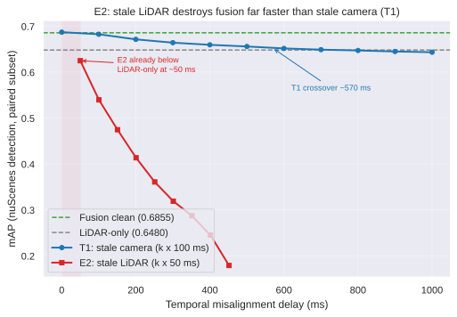

# E2: Stale LiDAR Backfires Instantly — No Plateau, Collapse to Zero

## Experimental design

**E2 (stale LiDAR, naive delayed pipeline)**: the mirror image of T1 (stale camera). For each val sample, the main LiDAR point cloud is replaced with the sample's own k-th past sweep along the `sample_data.prev` chain (k = 1–9), and the sweep list is truncated to `sweeps[k:]`. Camera images, calibration, poses and GT all stay at the current frame. Semantically this models "the LiDAR data arrives k cycles late at the fusion pipeline" — a naive delayed pipeline with no compensation. Both sensors run at 20 Hz, nominal delay ≈ k × 50 ms; actual delays from timestamps are in `e2_delay_table.md` (means 50.1–451.7 ms).

**Evaluation**: official nuScenes devkit, 11 prediction files (fusion clean, LiDAR-only, e2_k1–k9) evaluated paired on the common subset **n = 5,856** (6019 − 150 samples with zero sweeps − 4 samples with missing camera blobs; per-k subsets 5,865 for k1–k8, 5,856 for k9). All numbers reproduced exactly across two independent evaluation runs.

**Environment**: AutoDL RTX 4090 D, PyTorch 2.1.0 / CUDA 12.1, mmdet3d v1.4.0.

## Results

| Setting | delay ms (mean) | mAP | NDS |
|---|---|---|---|
| fusion clean | 0 | 0.6855 | 0.7155 |
| lidar-only | — | 0.6480 | 0.6970 |
| e2_k1 | 50.1 | **0.6247** | 0.6518 |
| e2_k2 | 100.5 | 0.5394 | 0.5733 |
| e2_k3 | 150.6 | 0.4744 | 0.5218 |
| e2_k4 | 200.7 | 0.4133 | 0.4756 |
| e2_k5 | 251.1 | 0.3606 | 0.4376 |
| e2_k6 | 301.2 | 0.3187 | 0.4089 |
| e2_k7 | 351.4 | 0.2869 | 0.3856 |
| e2_k8 | 401.6 | 0.2448 | 0.3466 |
| e2_k9 | 451.7 | 0.1787 | 0.2932 |

## Key findings

1. **Backfire is immediate**: E2 falls below the LiDAR-only baseline already at k1 (≈50 ms — one 20 Hz cycle of latency): 0.6247 < 0.6480. For comparison, the T1 (stale camera) crossover is ≈570 ms. Stale LiDAR backfires an order of magnitude earlier. **Fusion has not even one sampling period of buffer on the LiDAR branch.**
2. **No plateau**: a single step k1→k2 drops 8.5 pt; the decay never flattens, and k9 (≈452 ms) is still falling (0.1787, just 26% of clean).
3. **Same time constant, 16× amplitude**: exponential fits of mAP(d) (`scripts/temporal/fit_e2_decay.py`):
   - T1: mAP = 0.6355 + 0.0530·exp(−d/511 ms), R² = 0.994
   - E2: mAP = −0.144 + 0.842·exp(−d/498 ms), R² = 0.995

   The time constants are nearly identical (≈500 ms), but the decay amplitudes differ **16×** (0.842 vs 0.053). The negative asymptote of the E2 fit shows that "exponential + constant" is only an approximation there — the true behavior is a collapse toward zero with no floor.
4. **Contrast with T1**: T1 loses only 4.4 pt over ten bins (0.6855→0.6432) with a "drop-then-hug-the-floor" shape; E2 loses 50.7 pt over nine bins with monotonic, accelerating degradation. A stale camera branch loses semantic information (with local buffers such as small objects and night); a stale LiDAR branch destroys spatial geometry outright.

## Mechanism

In BEVFusion the LiDAR branch is the spatial backbone (BEV encoder) while the camera branch mainly supplies semantic complement. The loader ingests the stale sweep's points using the **current frame's ego pose and extrinsics**, which rigidly misplaces the entire point cloud in ego coordinates by "speed × delay": at 10 m/s, 50 ms is a global 0.5 m shift and 100 ms is 1 m. Every object is systematically offset from its GT position, center-distance matching fails en masse, and ego rotation during turns adds rotational misalignment. This is a global geometric corruption — unlike a stale camera, which only degrades semantics for a subset of objects — hence the immediate, total, unbuffered collapse.

This also strengthens the T1 conclusion: the robustness bottleneck of camera–LiDAR fusion is temporal consistency of the LiDAR branch; the camera branch is comparatively resilient.

## Limitations

- **Naive semantics**: E2 models a delayed pipeline *without* compensation (no motion compensation, no ego-motion alignment). Real LiDAR processing latency is usually far below 50 ms; this experiment answers "how expensive is it *if* LiDAR arrives late".
- **Subset mismatch**: the E2 eligible set (5,856) differs from the T1 set (5,712) — E2 additionally excludes zero-sweep samples. Cross-experiment comparison (T1 vs E2 curves here) uses within-subset numbers; absolute levels carry a ±0.3 pt subset bias, far below the 16× amplitude gap and the immediate-backfire conclusion.
- k stops at 9 (≈452 ms): mAP is expected to keep trending toward zero at higher delays with no new information, so it was not run.

## Artifacts

- Reports: `docs/temporal_misalignment/e2_report_2026-11-02_{en,zh}.md`; chart `results/temporal_misalignment/chart_e2_decay.svg`
- Code: `scripts/temporal/` (`cycle_e2.py`, `accum_e2.py`, `subset_eval.py`, `fix_missing_cam.py`, `fixcam_pass2.py`, `build_tok2blob.py`, `chart_e2.py`, `fit_e2_decay.py`)
- Delay stats: `docs/temporal_misalignment/e2_delay_table.md` (k1–k9 min/mean/median/max)
- Prediction JSONs (9 files, ~110 MB gz each): `e2_k{1..9}_cumulative.json.gz` — not in git by convention; distributed via Release
