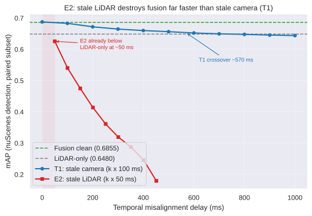

# E2：过期 LiDAR 对 Camera–LiDAR 融合的"背刺"——即刻发生、无平台、向零坍塌

## 实验设计

**E2（stale LiDAR，naive 延迟管道）**：与 T1（stale camera）互为镜像。对每个验证集样本，把主干 LiDAR 点云替换为该样本自己沿 `sample_data.prev` 链的第 k 个过去 sweep（k = 1–9），sweep 列表相应截断为 `sweeps[k:]`，相机图像、标定、位姿、GT 全部保持当前帧不变。语义上等价于"LiDAR 数据延迟了 k 个周期才到达融合管道"——一个不做任何补偿的朴素延迟管道。LiDAR 与相机均为 20 Hz，名义延迟 ≈ k × 50 ms，实际按时间戳统计（见 `e2_delay_table.md`，均值 50.1–451.7 ms）。

**评测**：官方 nuScenes devkit，11 个预测文件（fusion clean、LiDAR-only、e2_k1–k9）在共同子集 **n = 5,856** 上配对评测（6019 − 150 个零 sweep 样本 − 4 个相机图缺失样本；k1–k8 各档子集 5,865，k9 档 5,856）。全部数值经两轮独立评测完全一致（可复现）。

**环境**：AutoDL RTX 4090 D，PyTorch 2.1.0 / CUDA 12.1，mmdet3d v1.4.0。

## 结果

| 设置 | 延迟 ms（均值） | mAP | NDS |
|---|---|---|---|
| fusion clean | 0 | 0.6855 | 0.7155 |
| lidar-only | — | 0.6480 | 0.6970 |
| e2_k1 | 50.1 | **0.6247** | 0.6518 |
| e2_k2 | 100.5 | 0.5394 | 0.5733 |
| e2_k3 | 150.6 | 0.4744 | 0.5218 |
| e2_k4 | 200.7 | 0.4133 | 0.4756 |
| e2_k5 | 251.1 | 0.3606 | 0.4376 |
| e2_k6 | 301.2 | 0.3187 | 0.4089 |
| e2_k7 | 351.4 | 0.2869 | 0.3856 |
| e2_k8 | 401.6 | 0.2448 | 0.3466 |
| e2_k9 | 451.7 | 0.1787 | 0.2932 |

## 核心发现

1. **背刺即刻发生**：E2 在 k1（≈50 ms，一个 20 Hz 周期的延迟）就跌破 LiDAR-only 基线——0.6247 < 0.6480。对比 T1（stale camera）的交叉点 ≈570 ms，过期 LiDAR 的背刺提前了一个数量级。**对 LiDAR 支路而言，融合连一个采样周期的缓冲都没有。**
2. **衰减无平台**：k1→k2 单步下跌 8.5 pt，全程没有任何平缓段；k9（≈452 ms）仍在下跌（0.1787，只有 clean 的 26%）。
3. **时间常数相近、幅度差 16 倍**：指数拟合 mAP(d)（`scripts/temporal/fit_e2_decay.py`）：
   - T1：mAP = 0.6355 + 0.0530·exp(−d/511 ms)，R² = 0.994
   - E2：mAP = −0.144 + 0.842·exp(−d/498 ms)，R² = 0.995

   两个时间常数几乎相同（≈500 ms），但衰减幅度 0.842 vs 0.053，相差 **16 倍**。E2 拟合的负渐近线说明"指数 + 常数"模型在 E2 上只是近似——真实行为是向零坍塌、没有地板。
4. **与 T1 对照**：T1 十档总共只跌 4.4 pt（0.6855→0.6432），且是"跌穿后贴地板"的形态；E2 九档跌 50.7 pt，是单调加速恶化。相机支路 stale 损失的是语义信息（有小物体、夜间等条件下的局部缓冲），LiDAR 支路 stale 直接摧毁空间几何。

## 机理讨论

BEVFusion 的 LiDAR 分支是空间骨干（BEV encoder），相机分支主要提供语义补充。loader 用**当前帧的 ego pose 和外参**加载过期 sweep 的点云，等价于把整帧点云在自车坐标系里刚性错位一个"车速 × 延迟"的量：车速 10 m/s 时 50 ms 就是 0.5 m 的整体平移，100 ms 就是 1 m——所有物体同时偏离真值位置，检测框系统性偏移，mAP 的 center-distance 匹配大量失败。ego 在转弯时还会引入旋转错位。这是全局几何损坏，不像相机 stale 那样只损失部分物体的语义信息，所以表现为即刻、全面、无缓冲的坍塌。

这一结果也反向印证了 T1 的结论：融合的鲁棒性瓶颈在 LiDAR 支路的时间一致性，相机支路相对皮实。

## 局限

- **naive 语义**：E2 模拟的是"不做补偿的延迟管道"，不含运动补偿、ego-motion 对齐等工程手段；真实系统中 LiDAR 处理延迟通常远小于 50 ms，本实验回答的是"一旦 LiDAR 晚到，代价有多大"。
- **子集差异**：E2 资格集（5,856）与 T1 资格集（5,712）不同（E2 额外排除了零 sweep 样本）；跨实验对比（本文 T1 vs E2 曲线）用的是各自子集内的数值，绝对水平有 ±0.3 pt 量级的子集偏差，但 16 倍的幅度差和即刻背刺的结论远超该偏差。
- k 只到 9（≈452 ms）：更高延迟下 mAP 预计继续向零趋近，无新增信息，未跑。

## 产物

- 报告：`docs/temporal_misalignment/e2_report_2026-11-02_{zh,en}.md`，图表 `results/temporal_misalignment/chart_e2_decay.svg`
- 脚本：`scripts/temporal/`（`cycle_e2.py`、`accum_e2.py`、`subset_eval.py`、`fix_missing_cam.py`、`fixcam_pass2.py`、`build_tok2blob.py`、`chart_e2.py`、`fit_e2_decay.py`）
- 延迟统计：`docs/temporal_misalignment/e2_delay_table.md`（k1–k9 min/mean/median/max）
- 预测 JSON（9 个，各约 110 MB gz）：`e2_k{1..9}_cumulative.json.gz`，按仓库约定不入 git，随 Release 分发
