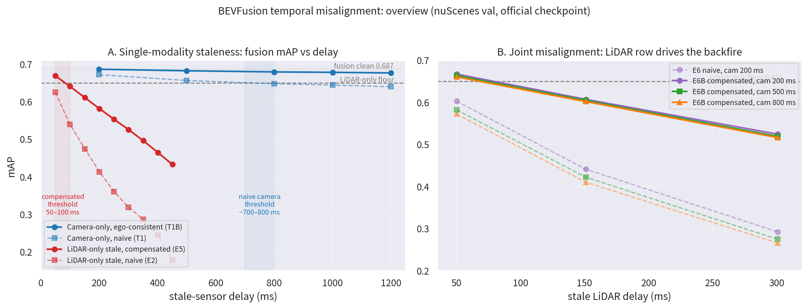

# Temporal Misalignment on BEVFusion: Complete Synthesis (T1/T1B, E1–E6, E6B)

**Date:** 2026-11-07
**Status:** COMPLETE — all inference done (100% coverage, zero skips), all evaluations on paired subsets
**Model:** BEVFusion camera–LiDAR fusion, official `bevfusion_lidar-cam_voxel0075` checkpoint, nuScenes val
**Owner:** @heyz (temporal misalignment line)

## 1. Executive summary

We perturbed the temporal alignment between BEVFusion's two sensor branches along two independent axes — **camera-frame staleness** (replace the current 6-camera keyframe with the k-th past keyframe) and **LiDAR staleness** (use the k-th past 20 Hz sweep as the main cloud) — in both *naive* form (data swapped, calibration/poses left at the current frame) and *ego-consistent* form (stale data delivered with its own capture-time calibration, or ego-motion compensated into the current frame). Across single-modality, joint, naive, and compensated settings, five findings are robust:

1. **Fusion backfires below its LiDAR-only fallback well before either modality "looks bad" in absolute terms.** Every stale-LiDAR setting backfires (naive: already at ~50 ms; compensated: between 50 and 100 ms). Stale camera backfires only at ~700–800 ms (naive) or ~1.2 s in miss-rate (ego-consistent).
2. **LiDAR freshness is the binding constraint; the camera budget is ~an order of magnitude more generous.** Ego-consistent camera staleness up to ~800 ms costs <1 mAP point when LiDAR is current.
3. **Ego-motion consistency is worth a lot but cannot fix stale dynamic content.** Ego-consistent delivery roughly halves the camera penalty (E6 → E6B camera columns) and rescues +16.6 mAP in the worst joint cell — yet compensated stale LiDAR still backfires, because moving objects sit at wrong positions in the stale sweep no matter how well the static geometry is warped.
4. **The mechanism is gradual recall erosion, then ghosting.** Camera staleness adds FN quietly (FP flat); moderate LiDAR staleness adds FN (moving classes first); deep LiDAR staleness (300 ms) additionally explodes FP — fusion hallucinates objects.
5. **Pedestrian is the canary.** It is the first class to lose fusion value in every analysis (T1B-FN, E4, E6B-FN), backfiring in miss rate even when overall metrics are above floor.

**Deployment law:** if the LiDAR sweep is older than ~50 ms, drop it and fall back to LiDAR-only (or run per-object temporal prediction/correction) regardless of ego-motion compensation; if LiDAR is current, camera frames up to ~1 s are usable as long as they arrive with their own calibration.

## 2. Experiment inventory

| ID | Manipulation | Semantics | Subset n | Report |
|---|---|---|---|---|
| T1 | camera stale k2–k12 | naive (current-frame calibration) | 5623 | `t1_temporal_misalignment_final_2026-10-27_en.md` |
| T1B | camera stale k2–k12 | ego-consistent (own calibration) | 5623 | `t1b_ego_consistent_camera_2026-11-05_en.md`, `t1b_k10_k12_extension_2026-11-06_en.md` |
| E1 | per-class decay & threshold | derived from T1 | 5712 | `e1_backfire_breakdown_2026-10-30_en.md` |
| E2 | LiDAR stale k1–k9, camera clean | naive | 5856 | E5/E6 reports |
| E4 | FP/FN decomposition | greedy 2 m, score≥0.1, unconditional FN | 5712 | `e4_fp_fn_analysis_2026-10-30_en.md` |
| E5 | LiDAR stale k1–k9, camera clean | ego-motion compensated | 5856 | `e5_motion_comp_report_EN.md` |
| E6 | joint 3×3 (cam k2/5/8 × lid k1/3/6) | both naive | 5719 | `e6_joint_misalignment_report_EN.md` |
| **E6B** | joint 3×3 | camera T1B + LiDAR E5 (both consistent) | 5719 | `e6b_joint_compensated_report_en.md` |
| T1B-FN | FN/FP of T1B series | E4 protocol | 5712 | `t1b_fn_analysis_en.md` |
| **E6B-FN** | FN/FP of E6B grid | E4 protocol | 5712 | `e6b_fn_analysis_en.md` |

All "subset n" values are paired common subsets on which every number in that row is directly comparable. Cross-row comparisons are approximate (different subsets). Delay mapping: camera keyframe ≈100 ms/step; LiDAR sweep ≈50 ms/step (20 Hz).

## 3. Headline numbers

### 3.1 Camera-only staleness (T1 vs T1B, n = 5623; floor = LiDAR-only 0.6501, clean 0.6875)

| delay | 200 ms | 500 ms | 800 ms | 1000 ms | 1200 ms |
|---|---|---|---|---|---|
| T1 naive | 0.6716 | 0.6562 | **0.6476 ↓** | 0.6439 | 0.6395 |
| T1B ego-consistent | 0.6860 | 0.6820 | 0.6789 | 0.6778 | 0.6762 |

Naive camera staleness backfires at ~700–800 ms; ego-consistent delivery stays above the floor out to 1.2 s in mAP and costs <1 point over 200→800 ms. **FN-decomposition caveat (T1B-FN, n = 5712):** the miss rate crosses above LiDAR-only at k12 (15.69% vs 15.53%), led by pedestrian (+1.6 pp) and car (+1.1 pp) — mAP says "safe", miss rate says "backfired"; the extra misses are low-confidence boxes, but for a safety stack the miss-rate statement is the operational one.

### 3.2 LiDAR-only staleness, camera clean (E2 vs E5, n = 5856; floor = 0.6480, clean 0.6855)

| delay | 50 ms | 100 ms | 151 ms | 201 ms | 251 ms | 301 ms | 351 ms | 401 ms | 451 ms |
|---|---|---|---|---|---|---|---|---|---|
| E2 naive | **0.6247 ↓** | 0.5394 | 0.4744 | 0.4133 | 0.3606 | 0.3187 | 0.2869 | 0.2448 | 0.1787 |
| E5 compensated | 0.6686 | **0.6405 ↓** | 0.6106 | 0.5813 | 0.5529 | 0.5254 | 0.4961 | 0.4647 | 0.4327 |

Naive stale LiDAR backfires *immediately* (~50 ms). Ego-motion compensation buys roughly one doubling of the budget: the backfire threshold moves to **50–100 ms**. Beyond the threshold the decay is steep and approximately linear in delay (~−0.3 pt per 10 ms at k3–k9).

### 3.3 Joint misalignment (E6 naive vs E6B both-consistent, n = 5719; floor = 0.6497, clean 0.6870)

mAP, camera k_c ∈ {2,5,8} (~200/500/800 ms) × LiDAR k_l ∈ {1,3,6} (~50/151/301 ms):

| | c2 | c5 | c8 | | c2 | c5 | c8 |
|---|---|---|---|---|---|---|---|
| **E6** l1 | 0.6028 | 0.5823 | 0.5723 | **E6B** l1 | 0.6671 | 0.6634 | 0.6604 |
| **E6** l3 | 0.4410 | 0.4222 | 0.4102 | **E6B** l3 | 0.6070 | 0.6042 | 0.6018 |
| **E6** l6 | 0.2922 | 0.2745 | 0.2656 | **E6B** l6 | 0.5242 | 0.5189 | 0.5161 |

- **E6 (both naive):** every cell backfires, including the mildest (camera 200 ms + LiDAR 50 ms, −4.7 pt vs floor). Damage is approximately additive across modalities, slightly super-additive at large delay.
- **E6B (both consistent):** the camera column becomes nearly free (200→800 ms costs 0.5–0.7 pt), the l1 row stays above floor, but **the entire l3 row backfires ~4.4–4.8 pt below floor**. The "compensate everything and fusion is immune" hypothesis is rejected; combined with §3.2, the joint stale-LiDAR threshold is below 100 ms.
- **E6B-FN mechanism (n = 5712):** l1/l3 rows are pure-FN damage (FP ≈ clean levels, 26.1–26.9k vs 25.9k); the l6 row shows an FP explosion (33–34k) — deep stale LiDAR makes fusion hallucinate. Camera columns add ~+1k FN per step with FP flat. Per-class: pedestrian backfires in miss rate already on the l1 row at c5/c8; car/motorcycle lead the l3-row backfire; large static classes (truck/bus/barrier/construction) retain fusion value longest.

## 4. Cross-cutting findings

1. **Decay is monotone and roughly linear in delay** once past a modality-specific knee; the knees are the deployment-relevant numbers.
2. **Backfire thresholds** (mAP, fusion vs LiDAR-only fallback): naive LiDAR <50 ms; compensated LiDAR 50–100 ms; naive camera ~700–800 ms; ego-consistent camera >1.2 s (mAP) / ~1.2 s (miss rate).
3. **Per-class ordering is stable across every analysis**: pedestrian → car/motorcycle → bicycle/trailer → large static classes. This is the temporal-side counterpart of the spatial team's distance finding and the input for the conditional-threshold work.
4. **Metric divergence**: camera-only staleness separates mAP (lenient) from miss rate (strict); stale LiDAR degrades both simultaneously. Both metrics, plus FP/FN decomposition, should be reported for fusion-robustness claims.
5. **Ego-consistency is the cheapest robustness upgrade available**: delivering stale frames with their own calibration requires no model change and halves the camera penalty; ego-motion compensation of LiDAR is worth ~50 ms of budget but cannot substitute for fresh LiDAR on dynamic content — per-object temporal prediction/correction (the team's robustness direction) is the remaining lever.

## 5. Limitations

- Single official BEVFusion checkpoint (cross-checkpoint robustness untested — top open item).
- Subset sizes differ per line (5623–5856); cross-line comparisons are approximate.
- Delay mapping assumes nominal keyframe/sweep cadence; per-sample actual timing was audited for T1B only.
- Compensation relies on dataset ego-pose accuracy; noisier real-world odometry would shrink the E5/E6B benefit.

## 6. Artifacts

- **Reports:** this directory (`results/temporal_misalignment/` on branch `jhe-sudo/temporal-misalignment`).
- **Predictions:** Releases `predictions-t1b` (T1B k2–k12) and `predictions-e6b` (9 joint cells); E2/E5 and T1/T1B full series on the experiment machine.
- **Eval logs:** `t1b2_subset_eval.out`, `e5_subset_eval.out`, `e6_subset_eval.out`, `e6b_subset_eval.out`.
- **FN/FP data:** `e4_fp_fn.json`, `e4_t1b_fn_summary.json`, `e4_e6b_fn_summary.json` (+ caches).
- **Drivers:** `scripts/temporal/` (`cycle_e5.py`, `cycle_e6.py`, `cycle_e6b.py`, `accum_*.py`, `e4_*.py`, `gen_condition_table.py`).
- **Condition table** for conditional analysis: 183,892 rows / GT box, delivered to @wangYilia (`results/remote_pull/condition_table.jsonl` locally).
