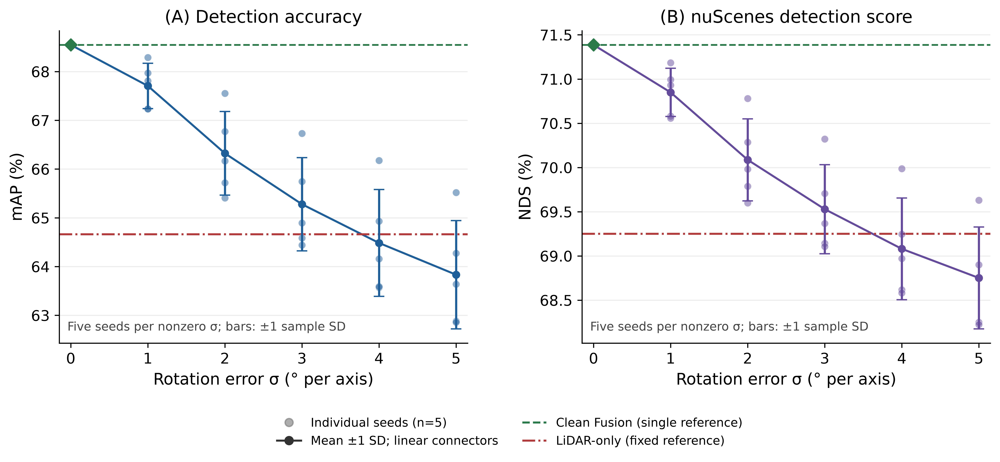

# Rotation robustness: completed validation study

This release provides the production inference overlay, official nuScenes mAP/NDS scoring, all 27 condition summaries, five-seed aggregation and final presentation figures.

## Results

| Rotation σ (degrees per axis) | mAP (%) | NDS (%) |
|---|---:|---:|
| 1 | 67.706 | 70.849 |
| 2 | 66.322 | 70.087 |
| 3 | 65.279 | 69.529 |
| 4 | 64.484 | 69.080 |
| 5 | 63.833 | 68.751 |

Clean Fusion: **68.547401% mAP / 71.386516% NDS**. LiDAR-only: **64.664666% / 69.250968%**. Each rotation level has seeds 0–4 and 6,019 validation samples per condition. The experiment uses persistent six-camera calibration rotation errors with frozen per-camera perturbations.

Both mean curves first fall below LiDAR at the tested **σ=4°**. Linear interpolated crossings are approximately **3.77° (mAP)** and **3.62° (NDS)**; these are estimates between tested points. Pointwise 95% mean-margin intervals include zero at both 4° and 5°, so the experiment does not establish a statistical threshold. Intervals use five seed-level observations, not 6,019 independent frame replicates. Baselines are fixed references. Error bars in the figure show sample SD.



[Presentation PDF](results/rotation_two_panel.pdf) · [All conditions](results/metrics_all_conditions.csv) · [Five-seed statistics](results/metrics_by_sigma.csv) · [Threshold analysis](results/threshold_analysis.md)

## Reproduce the presentation

From this directory, use Python with NumPy, SciPy and Matplotlib (the recorded plotting environment is in `evaluation/plot-requirements.txt`):

```sh
python evaluation/analyze_plot.py --recovered metrics --lidar-reference metrics/lidar-reference.json --output regenerated
```

The included official metric summaries and details are sufficient to regenerate the tables and figures without model inference or dataset access. `SHA256SUMS.json` records the distributed artifact bytes.

## Production inference pipeline

`pipeline/analysis/throughput/` contains the accepted bounded data loader, ordered writer, execution provenance and inference runner. `pipeline/analysis/batch_execution/` supplies authenticated frozen-manifest admission and archive verification. These files are an **overlay for the accepted BEVFusion runtime**, not a standalone environment installer. Install the overlay's `analysis` directory into that runtime project alongside its original `environment` package.

Required external artifacts are the original frozen BEVFusion environment (including experiment helpers, upstream identity and validation formatter), checkpoint, resolved configuration, nuScenes validation view, runtime cache and authenticated condition manifests. Their identities are recorded in `results/experiment_index.json`, `evaluation/inputs.json` and the frozen manifest registry. Preserve the complete original environment: its source fingerprint covers all original helper files. Dataset, checkpoints and prediction archives remain in their original storage and are not distributed here.

Within that prepared runtime, under the existing non-root read-only dataset guard:

```sh
python -m analysis.batch_execution.authenticated_entrypoint \
  --module analysis.throughput.runner \
  --manifest /path/to/original-condition-manifest.json \
  --config /path/to/matching-config.py \
  --output-root /path/to/output --workers 4 --prefetch 2 --writer-depth 2 --execute-gpu
```

The runner authenticates scientific identities, preserves token order and writes completed prediction handoffs. The original registry authenticates saved perturbations; use the original manifests rather than regenerating the completed experiment.

## Official evaluation

Run `evaluation/evaluate_grid.py` in the same prepared CPU-capable environment with nuScenes-devkit **1.1.9**, the upstream BEVFusion formatter and the **detection_cvpr_2019** configuration. `evaluation/inputs.json` is the recorded input manifest; mount the original artifacts at its paths or create a separate path-adapted copy while preserving identities.

```sh
python evaluation/evaluate_grid.py --input evaluation/inputs.json \
  --work /path/to/scratch --output /path/to/scored
```

Evaluation verifies archive receipts, hashes, condition identities, unique ordered sample tokens and dataset consistency before scoring. The completed grid comprises 25 nonzero conditions plus Clean Fusion and LiDAR-only references; accepted cached summaries are identified explicitly. `metrics/` contains the completed official outputs used for this presentation.

These results describe this checkpoint, fixed validation population and calibration-error design. Seed frequencies are descriptive; pointwise intervals are not simultaneous confidence bands or universal deployment guarantees.

`scientific_reference/` includes the exact rotation injection, manifest, handoff, dataset integrity and official formatting helpers for inspection. It is a selected source reference; execution uses the complete original fingerprinted environment described above.
