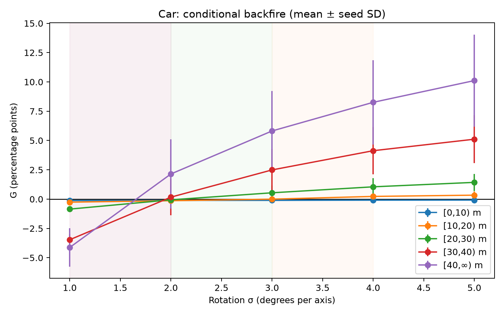
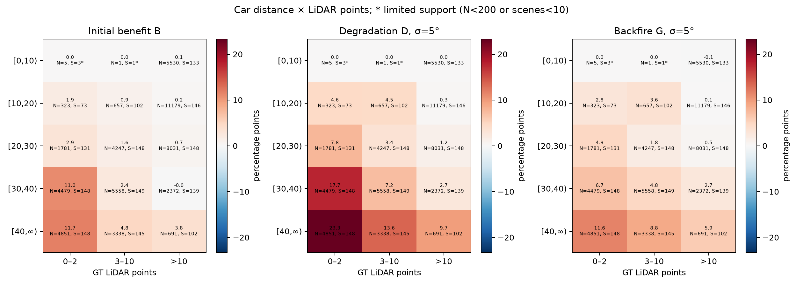
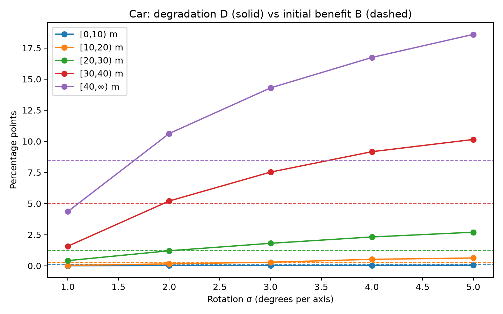

# Spatial Conditional Backfire

## Research question

Does rotational camera–LiDAR miscalibration reproduce Temporal's conditional fusion backfire pattern?

## Method

Object-level miss rates, **not official mAP/NDS**. Within each sample and class, predictions with confidence ≥0.1 are stably sorted by descending score and assigned to the nearest unmatched GT if BEV distance is strictly <2m. Equal scores retain prediction order; equal distances use original GT order. All unmatched eligible GT are misses. This replicates the actual float64 [Temporal conditional matcher](https://github.com/Strange-Noah/Camera-LiDAR-backfire/blob/nuo-ft-conditional-threshold/scripts/temporal/conditional_threshold/step2_match.py); the older E4 audit used float32. An extracted original matching function is retained for parity tests.

B = miss(LiDAR) − miss(clean); D = miss(noisy) − miss(clean); G = D − B. Differences are percentage points. Membership uses GT metadata only, with identical GT denominators across all conditions. Global XY matching; horizontal distance from LIDAR_TOP ego pose. GT eligibility follows nuScenes detection_cvpr_2019 filtering (range, point support and bike-rack logic), as in Temporal's e3 GT export. The ≥40m Car bin is effectively 40–50m because the accepted class range is 50m. Zero-LiDAR-point GT can remain eligible if radar support exists.

## Experimental setup

Complete validation population: **6,019 samples, 53,043 Car annotations, 150 scenes**, one accepted LiDAR reference, one Clean Fusion reference, and 25 existing rotation conditions (σ=1–5°, seeds 0–4). No predictions regenerated and no official scoring rerun. Annotation keys combine sample_token and annotation_token. All 27 formatted prediction hashes and frozen infos/13 metadata-table identities passed verification. Rotation archives/receipts and accepted evaluator outputs link the conditions to the original experiment.

## Results

| Distance (m) | GT N | B (pp) | mean D at 5° | mean G at 5° | G>0 seeds at 5° | Observed upward bracket (°) |
|---|---:|---:|---:|---:|---:|---|
| 0–10 | 5536 | 0.126 | 0.043 | -0.083 | 0/5 | none |
| 10–20 | 12159 | 0.288 | 0.627 | 0.339 | 4/5 | [[3, 4]] |
| 20–30 | 14059 | 1.266 | 2.696 | 1.430 | 5/5 | [[2, 3]] |
| 30–40 | 12409 | 5.037 | 10.149 | 5.112 | 5/5 | [[1, 2]] |
| ≥40 | 8880 | 8.480 | 18.592 | 10.113 | 5/5 | [[1, 2]] |

Farther Car groups lose more fusion benefit and show earlier observed mean crossings in this experiment. Near 0–10m retains a small advantage throughout. These brackets describe observed means, not statistically established physical thresholds. All individual seeds, seed SD, seed backfire counts, baseline rates and scene-only 95% percentile intervals are in [summary.json](results/summary.json); [per-seed table](results/distance_seed_values.csv).





Each figure also has PDF/SVG exports. Error bars show sample SD across five seeds. Scene intervals use 500 complete-scene paired bootstrap replicates with fixed seed 20261104, conditional on the five observed calibration seeds; they do not include seed-population uncertainty. Seed counts are descriptive. Shared baselines and seed identities are retained across σ. Sparse cells are explicitly flagged. One cell (30–40m, >10 LiDAR points) has B≤0 and must not be described as a newly induced backfire transition. LiDAR-sparse far cells show greater degradation, an association rather than causal isolation of point count.

## Temporal comparison

The qualitative **benefit–degradation mechanism agrees** with [Temporal's actual results](https://github.com/Strange-Noah/Camera-LiDAR-backfire/blob/nuo-ft-conditional-threshold/scripts/temporal/conditional_threshold/README.md): camera benefit grows at far range, and misalignment can erase more than that initial benefit. Spatial far-range D rises strongly (18.592pp at ≥40m versus 0.043pp at 0–10m at σ=5°). This is compatible with Temporal's distance amplification, but Temporal also conditions on relative image displacement and reports that near-car crossings with B≈0 are uninformative. Thus these results do not establish identical conditions or an unconditional universal 'farther always earlier' Temporal rule.

Temporal uses 5,712 samples and a different model/runtime; delay and rotational σ have different physical units. No absolute threshold comparison is warranted. Temporal reports an unresolved small FP discrepancy between release and earlier local prediction copies; its conditional miss counts reconcile. This study measures GT misses, not false-positive effects. No per-object projection, trajectory, velocity or displacement analysis was added.

## Reproduction

Use the existing plotting environment specified by [plot-requirements.txt](../evaluation/plot-requirements.txt). From this directory:

```sh
python test_core.py
python aggregate.py results/scene_counts regenerated-summary.json
python plot.py regenerated-summary.json regenerated-figures
```

`results/scene_counts` retains counts for every scene × subgroup × condition, allowing summary/figure regeneration without model or dataset access. `extract.py CONFIG OUTPUT` performs CPU-only extraction from retained formatted predictions and original nuScenes metadata. CONFIG contains the accepted evaluation settings and all condition paths plus expected SHA256 values. Private storage paths are intentionally not published. Use the existing frozen runtime and the original evaluation settings, not invented identities. An incomplete extraction leaves verified per-condition NPZ files and a ledger for recovery; never reuse a partial run as accepted data. Resume with `extract.py CONFIG OUTPUT --resume`; it revalidates input identities, the canonical denominator and saved cache hashes before reusing completed conditions.

[Scientific validation](VALIDATION.md). The original [rotation mAP/NDS study](../README.md) remains a separate unchanged result.
