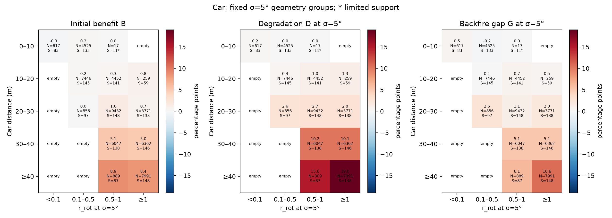
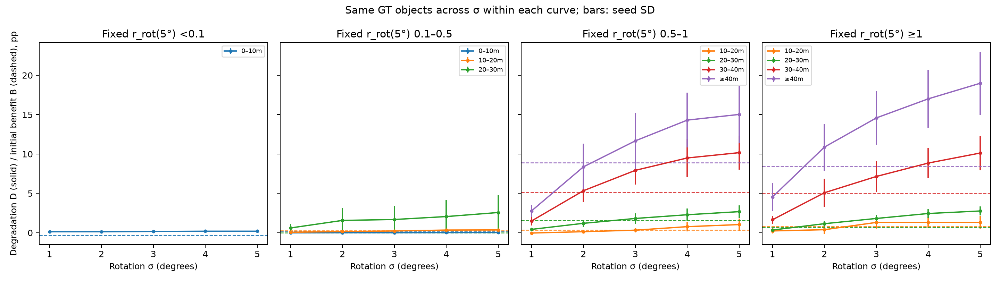
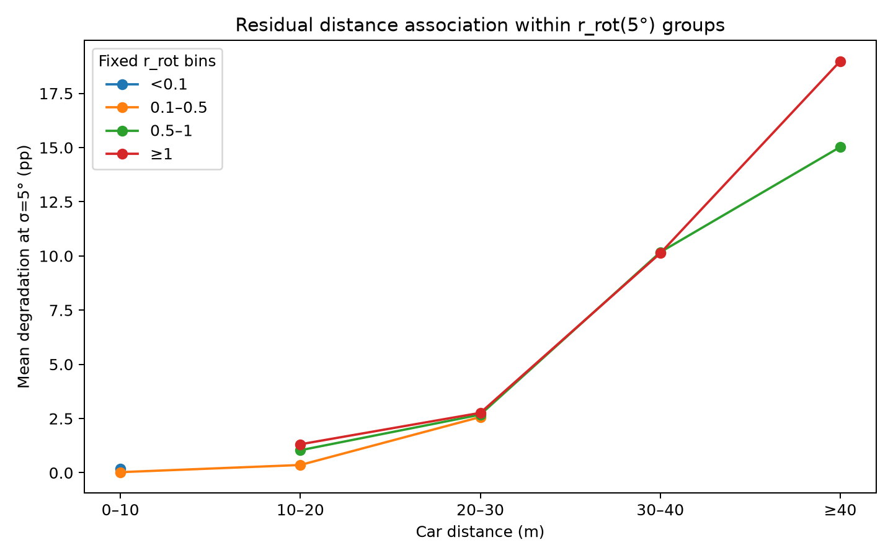

# Spatial normalized rotational displacement

## Finding

**The prespecified r_rot adds some within-distance separation, but does not remove the strong distance association.** It does not transfer Temporal's full displacement-based explanation as a single sufficient Spatial indicator.

At σ=5°, mean degradation (percentage points) is:

| Car distance (m) | r<0.1 | 0.1≤r<0.5 | 0.5≤r<1 | r≥1 |
|---|---|---|---|---|
| 0–10 | 0.194 (N=617) | 0.027 (N=4525) | 0.000 (N=17) | empty |
| 10–20 | empty | 0.357 (N=7446) | 1.038 (N=4452) | 1.313 (N=259) |
| 20–30 | empty | 2.570 (N=856) | 2.680 (N=9432) | 2.763 (N=3771) |
| 30–40 | empty | empty | 10.174 (N=6047) | 10.126 (N=6362) |
| ≥40 | empty | empty | 15.028 (N=889) | 18.989 (N=7991) |

Within 10–20m, degradation increases from 0.357 to 1.038 to 1.313pp across supported displacement bins. At ≥40m it increases from 15.028 to 18.989pp. However, 20–30m changes little (2.570–2.763pp), and 30–40m shows almost no ordering (10.174 vs 10.126pp). Thus added information is limited and inconsistent across distance strata.

Distance retains a large residual association: within the fixed 0.5≤r<1 group, mean degradation grows from 1.038pp at 10–20m to 15.028pp at ≥40m. Within r≥1 it grows from 1.313 to 18.989pp. These are coarse-bin associations, not regression-adjusted or causal effects; the distribution of continuous r within each bin can still differ.

## One predefined normalization

`geometry.py` uses the exact original **camera-local right-multiplication** convention. The frozen mechanism samples an isotropic three-dimensional Gaussian rotation vector, with per-axis SD equal to σ in radians, and converts it using Rodrigues. No original matrices/manifests are regenerated.

The primary value is a **first-order small-angle RMS approximation**: multiply the Frobenius norm of the pixel-projection Jacobian with respect to the local rotation vector by σ in radians, then divide by the clean projected horizontal box width. Its units are projected object widths. This expectation uses the distribution covariance, not five realized seeds or an identical deterministic rotation for all cameras.

This is not asserted to equal the exact nonlinear projection second moment. Under an unbounded rotation distribution, pinhole camera-plane poles can make that exact moment ill behaved. The linearized quantity is finite and interpretable; approximation error at 5° has not been globally bounded. No normalization or coefficients were tuned after outcomes.

Clean visibility is geometric: center inside the raw camera image, all eight box corners more than 1m in front, projected width greater than 1 pixel. From valid cameras, select the largest clean projected width, with ties retaining the original fixed six-camera order. Selection is independent of hits, σ and seed. Projections use original camera calibration and its timestamp-specific ego pose. Width is the full horizontal corner span, not clipped to the image. Occlusion and network augmentation/cropping are not modeled.

## Population and grouping

All **53,043** original eligible Car identities and all original hit/miss labels are preserved. **52,664** have a valid selected projection; **379 (0.715%)** remain explicitly unassigned and have a separate miss-rate summary. These geometrically conditioned results must not be presented as a projection assignment for every eligible Car. The original 6,019-sample validation population is unchanged; 5,718 samples contain these Car observations. No-car samples contribute no Car GT denominator. No intersection of prediction populations was made.

Original distance bins and Yilia's four r bins are used unchanged. Seven of the 20 fixed σ=5° cells are empty, and the near 0.5–1 cell has only 17 objects. Counts and scenes are shown; cells with N<200 or fewer than 10 scenes are flagged and excluded from the residual-distance plot and D-versus-B curves. Bin support is strongly imbalanced and limits interpretation. No alternative normalization was tried to improve the pattern.

- [Dynamic tables](results/distance_r_sigma.csv) use each σ's r_rot. Membership can change across σ. Each subgroup has a denominator identity hash. Adjacent-level crossings in [dynamic_crossings.json](results/dynamic_crossings.json) are composition-dependent descriptions, not paired-object thresholds.
- Figures B/C and the fixed tables in [summary.json](results/summary.json) freeze membership using **r_rot at σ=5°**. Each curve therefore compares exactly the same objects across σ, retains five separate seeds and uses a fixed B reference. For example, at ≥40m, fixed 0.5–1 and ≥1 groups cross at 2°–3° and 1°–2°, respectively.
- All rates/differences use the accepted B/D/G signs. B≤0 groups already lack clean benefit and are not newly induced backfire transitions. Seed SD is descriptive. Reused paired scene-bootstrap intervals condition on the five observed seeds and do not quantify seed-population uncertainty.

## Figures





PNG/PDF/SVG exports are retained. A uses one σ=5° population in all three panels. B uses fixed populations across σ. C omits unsupported cells.

## Relation to Temporal

[Yilia's accepted study](https://github.com/Strange-Noah/Camera-LiDAR-backfire/tree/nuo-ft-conditional-threshold/scripts/temporal/conditional_threshold) found greater degradation with displacement and distance amplification at fixed displacement. Spatial agrees qualitatively with the residual distance amplification. It shows only partial within-distance displacement ordering, so these results do **not** establish that the same physical variable explains both interventions equally well.

Temporal relative lateral displacement and Spatial linearized rotational RMS are distinct quantities and use different populations/models. Camera aggregation, projected-width geometry, broad bins and Gaussian linearization limit direct comparison. There is no unified threshold or causal mechanism claim. The present normalization is useful as a limited descriptive stratifier, and insufficient as a complete explanation beyond distance. This phase stops here.

## Reproduction

Reuse the original frozen metadata and accepted `conditional/extract.py` object table and 27 hit NPZ caches. `compute.py` requires the original nuScenes-devkit 1.1.9 / pyquaternion environment and clean metadata; aggregation/plotting uses NumPy and Matplotlib from the parent plotting specification.

```sh
python test_geometry.py
python compute.py --objects ORIGINAL_OBJECTS.json --dataroot ORIGINAL_NUSCENES --output geometry.json.gz
python analyze.py --labels ACCEPTED_EXTRACTION_DIRECTORY --features geometry.json.gz --output fresh-results
python analyze.py --summary results/summary.json --output regenerated-figures
```

Private storage paths and geometry caches are not published. No inference, E4 rematching, official rescoring, model design or training is performed. [Focused validation](VALIDATION.md).
